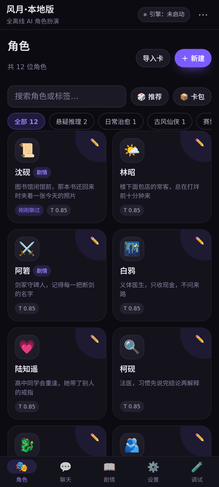
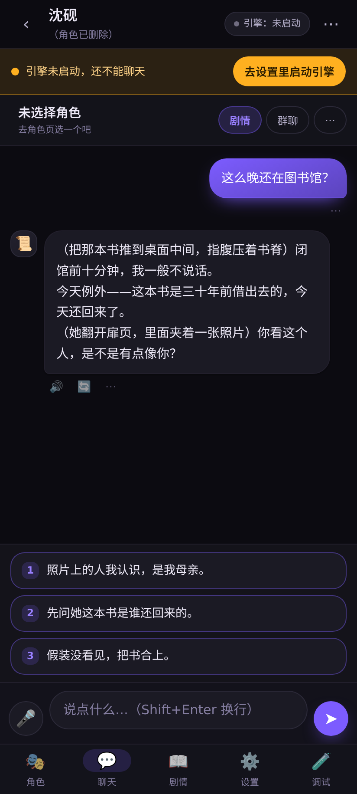
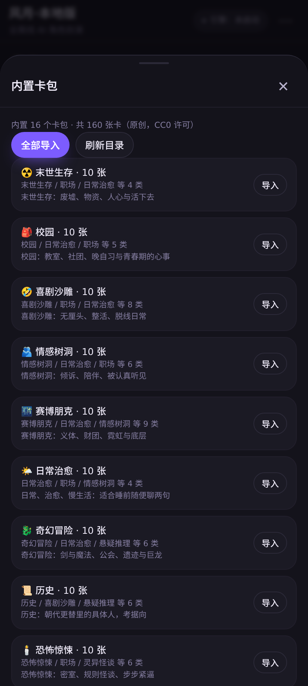
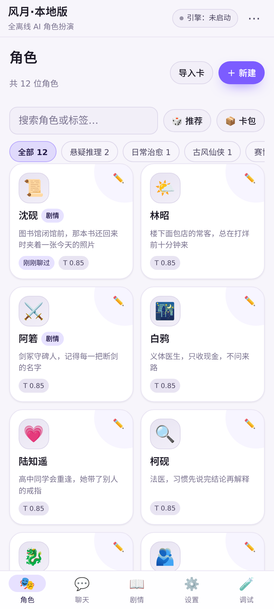
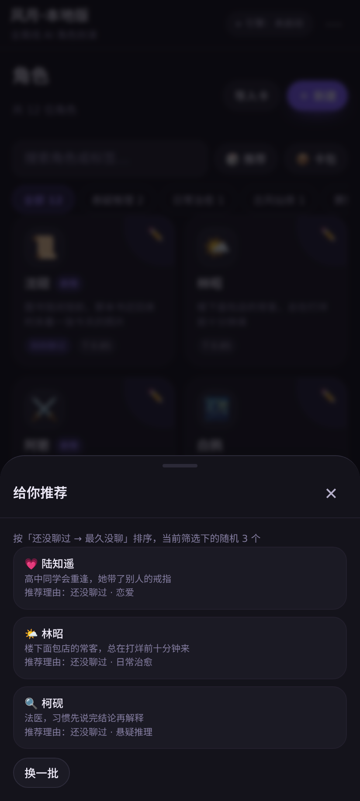
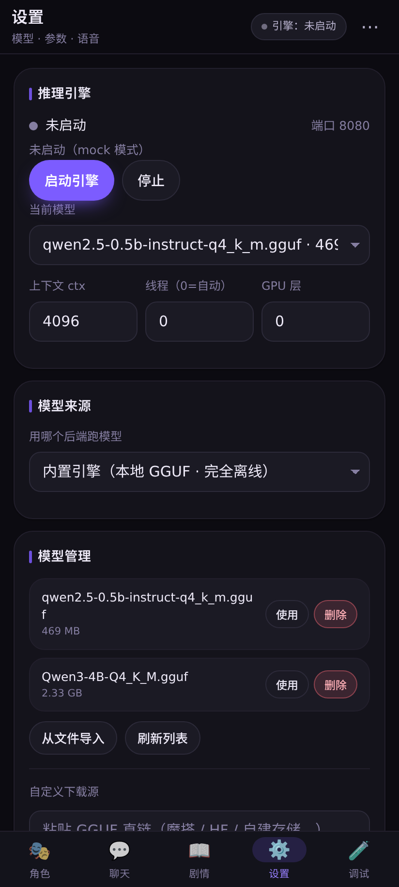

# 风月·本地版（fy）

<!-- 仓库：https://gitee.com/zhao-jiurong/wind-and-moon-local-edition -->
[](LICENSE)
[-green.svg)](#环境要求)
[](#为什么是这套架构)

一个**完全离线**的 Android AI 角色扮演 App：llama.cpp 推理引擎和 GGUF 大模型全部在手机本地跑，
不登录、不联网、不上传对话。整个 App 在 Termux 里从零构建，不需要 Android Studio / NDK / Gradle。

```
角色卡陪聊 · 流式输出 · 长期记忆 · 剧情选项玩法 · 多角色群聊 · 语音朗读与语音输入
角色卡导入导出（SillyTavern chara_card_v2，.json / .png 都吃）· 整库备份/恢复
多存储后端（IndexedDB / SQLite / localStorage / 内存，可一键迁移）· 跨会话聊天记录搜索
内置 160 张原创卡（16 个分类，角色卡 + 剧情卡）· 分类筛选 / 搜索 / 智能推荐 / 卡包一键导入
模型来源自由选：内置引擎（本地 GGUF）/ 粘贴链接下载任意模型 / 连局域网自建或云端 OpenAI 兼容服务
深色 / 浅色 / 跟随系统三档外观 · 手写 Material 3 风格设计系统（无任何外部素材）
```

## 快速开始

**装现成的**：到 [发行版](../../releases) 下载 `fy.apk`（约 13MB），手机上点开安装
（需要允许「安装未知来源应用」）。首次启动后到 **设置 → 模型** 下载或导入一个 GGUF 模型即可开聊。

**自己构建**（Termux 或任意 Linux，不需要 Android Studio / Gradle / NDK）：

```bash
git clone https://gitee.com/zhao-jiurong/wind-and-moon-local-edition.git && cd wind-and-moon-local-edition
./tools/fetch-deps.sh     # 拉两个第三方大件：llama.cpp 预编译引擎 + android.jar
                          # 国内网络慢的话见 CONTRIBUTING 里的「依赖镜像」一节
./build.sh                # 产出 fy.apk（release 签名）
```

详见 [CONTRIBUTING.md](CONTRIBUTING.md)。

### 环境要求

| 项 | 要求 |
|---|---|
| 系统 | Android 10+（minSdk 24），**arm64** 设备 |
| 内存 | 建议 6GB+；0.5B 模型约需 1GB 空闲，3B 约需 3.5GB（内存不够会疯狂换页，实测能慢到十分钟吐不出一个字） |
| 存储 | 模型 0.5～2.5GB + App 本体 13MB |

## 界面预览

<table>
<tr>
<td width="33%"><br><sub>角色页 · 分类筛选 / 搜索 / 推荐 / 卡包</sub></td>
<td width="33%"><br><sub>聊天页 · 流式对话与剧情选项</sub></td>
<td width="33%"><br><sub>内置卡包 · 16 类 160 张一键导入</sub></td>
</tr>
<tr>
<td width="33%"><br><sub>浅色主题（也可跟随系统）</sub></td>
<td width="33%"><br><sub>智能推荐 · 还没聊过的优先</sub></td>
<td width="33%"><br><sub>设置 · 引擎 / 模型来源 / 存储后端</sub></td>
</tr>
</table>

> 这些图是 `./tools/shots.sh` 用无头 Chromium 自动生成的（`tools/preview-seed.js` 注入假数据），
> 改完界面重新跑一次即可，不需要真机也不需要 Android Studio。

## 现状

| 项目 | 状态 |
|---|---|
| 引擎在本机跑通（真实推理） | ✅ Qwen3-4B Q4_K_M：生成 12.0 tok/s，预填充 47.6 tok/s，加载 19～60s |
| APK 构建（Termux 内，无 IDE） | ✅ `fy.apk` **13.0 MB**，含引擎，签名校验通过 |
| APK 安装前结构校验 | ✅ resources.arsc 未压缩+4 字节对齐、清单开关正确、引擎库齐全 |
| 前端功能（jsdom 集成测试） | ✅ **90 项通过**（流式/思考段/选项/群聊/记忆/语音/设置/自检/诊断导出/提示词回吐/弹层可隐藏/角色卡） |
| `Engine.java` 真跑（JVM + 真引擎） | ✅ **14 项通过**：自检、状态机、真实流式对话、干净停止（0.5B / 4B / 3B+mlock 都跑过） |
| 真实前端 + 真实模型端到端 | ✅ `tests/e2e-real.mjs`：角色扮演质量、剧情选项、记忆摘要，全部走真 4B 推理 |
| 剧情选项成功率 | ✅ 真模型连跑 5 轮 **5/5** 解析出选项（含无标记时的兜底解析） |
| `AssetServer.java` 真跑（JVM） | ✅ **17 项通过**：路由/MIME/query/404/并发/只监听回环不暴露局域网 |
| 角色卡解析真跑（JVM） | ✅ **6 项通过**：`PngCardText` 解 PNG 的 `tEXt`/`zTXt`/`iTXt` 三种卡块（含截断文件不崩） |
| 本地数据库 | ✅ **四个后端**（IndexedDB / SQLite / localStorage / 内存）+ 一键迁移 + 跨会话搜索；内存索引 + 增量落盘；修掉「设置表每次保存被清空」的持久化 bug |
| 界面主题 | ✅ 深/浅/跟随系统 + 强调色对比度自适应，有 jsdom 回归测试（12 项） |
| 前端 jsdom 覆盖 | ✅ 196 项：含数据库持久化、备份恢复、token 自校正、多后端协议、搜索界面、分类/推荐/卡包导入、模型来源路由 |
| 外部模型代理 | ✅ 15 项 JVM 实跑（假上游）：路由拼接、body 逐字节转发、key 注入、**SSE 实时透传**、502 快速失败 |
| 内置卡包 | ✅ 16 个分类 / 160 张原创卡（CC0），随 APK 发布，有发布前真实性校验 |
| 性能实测脚本 | ✅ `tests/bench-flags.mjs`（启动参数 A/B）、`tests/bench-prefix.mjs`（前缀复用）、`tests/bench-db.mjs`（数据库真实规模） |
| 模型下载（断点续传） | ✅ 对真实 ModelScope 实测：重定向跟随、Range 206、续传逐字节一致 |
| 在真机上安装并对话 | ✅ **Redmi Turbo 3 / Android 16 上跑通**。0.5B：预填充 **144 tok/s**、生成 **4.73 tok/s**、单轮 ~25s，流式/剧情/后台都验证过；3B 能加载，但在这台机器当前内存下会被换页拖死（见「踩过的坑」17、18） |

> 「JVM 真跑」的做法：给用到的几个 Android API 写了最小桩（`tests/jvmstub/`），
> 于是在 Termux 里就能直接 `java EngineJvmTest`，用真实的 llama-server 走完整流程 ——
> 不需要 Android 设备、不需要模拟器。这条路的收获见下面"踩过的坑"第 10 条。

## 为什么是这套架构

| 需求 | 做法 |
|---|---|
| 真·单机 | llama.cpp 官方 **Android arm64 预编译** `llama-server` 内置进 APK，模型放本地 |
| 不装 NDK / 不交叉编译 | 二进制改名成 `libfy_llama_server.so` 放进 `jniLibs`，装完在 `nativeLibraryDir` 里 exec |
| APK 不臃肿 | 只留 server 需要的库 + `strip`：引擎 276MB → **27MB**，APK 13MB |
| 前端体验好 | WebView + 本地 http 资源服务器（真实 origin），前端用 IndexedDB + `fetch` 直连推理端口 |
| 全程 Termux 内构建 | `javac` → `d8` → `aapt2` → 自写 `packapk.py`（代替 zipalign）→ `apksigner` |

关键结论都有实证，见 [docs/engine-exec.md](docs/engine-exec.md)（SELinux 策略依据、页对齐、GPU 结论）。

## 目录

```
~/2/fy/
├── build.sh              # 一键出 APK
├── deploy.sh             # 装到手机 + 推模型 + 启动 + 抓日志（需要 adb）
├── checkup.sh            # 不需要 adb 的装机/运行体检（读 App 自己写的诊断报告）
├── bench.sh / bench2.sh  # 引擎速度实测（cpu / gpu、含加载耗时）
├── tools/
│   ├── packapk.py        # 打包 + zipalign 对齐（Termux 没有 zipalign）
│   └── checkapk.py       # APK 硬性要求校验（对齐/清单/引擎文件）
├── tests/
│   ├── ui.test.mjs              # 前端 jsdom 集成测试（67 项）
│   ├── e2e-real.mjs             # 真实前端 + 真实 4B 模型端到端（角色扮演/剧情/记忆）
│   ├── probe-speed.mjs          # 量化预填充 vs 生成耗时（定位多轮变慢）
│   ├── probe-plot.mjs           # 剧情选项成功率统计
│   ├── probe-prompts.mjs        # prompt 合规性对照实验
│   ├── EngineJvmTest.java       # Engine.java 真跑：自检/状态机/推理/停止（14 项）
│   ├── AssetServerJvmTest.java  # AssetServer.java 真跑：路由/MIME/404/并发/回环（17 项）
│   ├── CardIOJvmTest.java       # PNG 角色卡解析真跑：tEXt/zTXt/iTXt（6 项）
│   ├── DownloadResumeTest.java  # 下载与断点续传实测（逐字节比对）
│   └── jvmstub/                 # 让上面几个 Java 测试能在 JVM 跑的 Android 最小桩
├── runtests.sh           # 一条命令跑完上面全部（--quick 跳过要起引擎的）
├── app/
│   ├── AndroidManifest.xml
│   ├── java/com/fy/local/
│   │   ├── MainActivity.java   # 组装 + 生命周期 + 事件推送到前端
│   │   ├── AssetServer.java    # 本地静态资源服务器（给 WebView 一个真 origin）
│   │   ├── Engine.java         # llama-server 子进程管理 + 状态机 + exec 回退 + 启动自检
│   │   ├── Bridge.java         # window.FY 原生桥
│   │   ├── ModelStore.java     # 模型 列表/导入/下载(断点续传)/删除
│   │   ├── Diag.java           # 诊断报告落盘到 Download（无需 adb 的反馈通道）
│   │   ├── CardIO.java         # 角色卡文件读写（JSON/PNG → 文本；导出到 Download）
│   │   ├── PngCardText.java    # PNG 里 tEXt/zTXt/iTXt 卡块解析（纯逻辑，可在 JVM 真跑）
│   │   ├── FyService.java      # 引擎前台服务（防后台冻结）
│   │   └── Speech.java         # 系统 TTS + 语音识别
│   ├── assets/ui/              # 前端（index/style/app/store/cards/mock/presets）
│   └── res/values/strings.xml
├── native/               # 要打进 APK 的引擎文件（engine/payload 的副本）
├── engine/               # llama.cpp 二进制（下载/解包/strip 的中间产物）
├── models/               # 本地 GGUF
├── sdk/android-36/       # android.jar（javac / d8 用）
├── docs/
│   ├── bridge-api.md     # JS ↔ Java 接口契约
│   ├── engine-exec.md    # 「为什么能 exec APK 里的二进制」证据链
│   └── user-guide.md     # 使用说明（装/选模型/玩法/排错）
└── fy.apk                # 构建产物（同时会拷一份到 Download/fy.apk）
```

## 构建 / 部署 / 测试

```bash
cd ~/2/fy
./build.sh                     # 出 fy.apk（自动做对齐校验，不通过就报错）
./checkup.sh                   # 不需要 adb：看装没装、看 App 自己写的诊断报告
./deploy.sh install            # 装到手机（需手机「无线调试」在线）
./deploy.sh model-small        # 推 0.5B 小模型（快速验证）
./deploy.sh model              # 推 4B 主模型
./deploy.sh run                # 启动 App
./deploy.sh logs               # 跟日志
cd tests && node ui.test.mjs   # 前端集成测试（需先 npm install jsdom fake-indexeddb）
cd tests && java DownloadResumeTest  # 实测下载/断点续传
```

## 实测性能（Redmi Turbo 3 / 骁龙 8s Gen 3 / 8 核 / 12GB）

**同一个引擎，速度由「线程数 / CPU 调度 / 前缀缓存 / 内存换页」四件事决定**，
下面全部是这台机器上用 `tests/bench-flags.mjs`、`tests/bench-prefix.mjs` 实测出来的：

| 模型 | 线程 | 加载 | 预填充 | 生成 | 常驻内存 |
|---|---|---|---|---|---|
| Qwen2.5-0.5B Q4_K_M | **4** | 2 s | 105～112 t/s | **42～52 t/s（稳定）** | 584 MB |
| Qwen2.5-0.5B Q4_K_M | 6（旧默认） | 2 s | 105～155 t/s | 24～57 t/s（**抖动极大**） | 577 MB |
| Qwen2.5-0.5B Q4_K_M | 8 | 2～16 s | 100～126 t/s | 11～35 t/s（更差） | 576 MB |
| Qwen2.5-3B Q4_K_M | **4** | **8 s** | 35 t/s | **11.5 t/s** | 2211 MB |
| Qwen2.5-3B Q4_K_M | 6（旧默认） | 17 s | 42 t/s | 11.3 t/s | 2208 MB |
| Qwen3-4B Q4_K_M | 6 | 19～60 s | 47.6 t/s | 1.1～5.9 t/s（内存紧时） | 2.4 GB |

### 三个反直觉的结论（都有实测数据）

1. **线程数不是越多越好，4 才是甜点**。这台机器是 2 小核 + 5 中核 + 1 大核，
   llama.cpp 是同步并行 —— 只要有一个慢核参与，每次同步点都得等它，
   于是 6/8 线程不但不快，速度还剧烈抖动（11～57 t/s）。
   代码里的默认值已从「0.75×核数」改成 **`min(4, 核数-1)`**（见 `Bridge.java`）。
2. **`-fa`（Flash Attention）和 KV 量化在这台机器上是负优化**：
   0.5B 上 `-fa`+`q8_0` 生成 24.4 vs 基线 20.6（噪声内），
   3B 上反而掉到 8.7 t/s（基线 11.3）、预填充 22 vs 42 t/s。所以**默认不开**。
3. **`-ub 128` 明显更慢**（预填充 61 vs 112 t/s），b/ub 保持默认。

### 每轮要重新预填充多少 —— 前缀形态决定

`tests/bench-prefix.mjs` 用同一段对话对比两种"发送形态"：

| 形态 | 第 2 轮需要预填充 | 耗时 |
|---|---|---|
| 旧：时间戳在【发送时】追加到最后一条（历史里没有） | **75 token** | 0.94 s |
| 新：时间戳由消息自身的 `ts` 推导（历史与发送形态一致） | **42 token** | 0.53 s |

差的就是「上一轮用户消息 + 助手回复」被重算的部分 —— 真实对话里那是几百 token。
相应地：剧情格式要求也搬回 **system prompt**（静态，只有切换剧情开关时会失效一次），
不再往每条消息里塞「（提醒：…）」。

### CPU 调度：后台 = 慢 4 倍

Android 会给应用分 cpuset：`/foreground` 能用全部核心，`/background` 只能用慢核。
实测同一个 0.5B：Termux（`cpuset:/foreground`）**48 t/s**，
App 退到后台时（`cpuset:/background`）只有 **4.7 t/s** —— 差 10 倍量级。
所以「切到后台继续生成」不仅会被冻结，就算没冻也会被限核。
`FyService` 前台服务 + 生成期间的唤醒锁就是为了尽量别落到 `/background`。

### 界面与主题

- **三档外观**：深色（默认，呼应"风月"的夜色）/ 浅色 / 跟随系统，设置页一键切换；
  深浅两套色值都走同一批语义令牌（`--surface-*` / `--text-*` / `--accent-*`），切换只改一个 `data-theme`；
- **设计系统**：形状（8/12/16/20/28px 阶梯）、字阶、动效（120/220/380ms 三档 + 标准/强调缓动）、
  阴影层级全部令牌化，改主题只动 `:root` 一处；
- **组件语言**参考公开设计规范（Material 3 的色角色 / 导航活动指示器 / 底部弹层，iOS 的聊天气泡节奏），
  但**没有照搬任何具体 App 的界面或素材** —— 图标是系统 emoji，图形全是 CSS 画的，仓库里可商用零授权风险；
- 强调色会按主题自动调对比度（深色提亮、浅色压深），避免"浅色主题下按钮文字看不清"；
- 尊重 `prefers-reduced-motion`，动效可被系统关掉。

生成截图（无头 Chromium，不需要真机，也不用 Android Studio）：

```bash
pkg install x11-repo && pkg install chromium   # 一次性
./tools/shots.sh                               # 输出到 docs/shots/
```

`tools/preview-seed.js` 会注入一份假数据并把界面摆到指定状态（角色页 / 聊天页 / 卡包页 / 推荐 / 设置···），
所以每次改完样式都能重新出一套图，而不是靠肉眼猜。

### 模型来源：本地引擎 / 局域网自建 / 云端 API

设置页「**模型来源**」二选一：

| 模式 | 说明 | 典型填法 |
|---|---|---|
| **内置引擎** | 默认。模型跑在手机本地（llama.cpp + GGUF），完全离线 | 从内置源下载，或「自定义下载源」粘任意直链 |
| **外部服务** | OpenAI 兼容接口。既覆盖**局域网自建**（不要 key），也覆盖**云端 API**（要 key） | Ollama `http://电脑IP:11434/v1` · LM Studio `http://电脑IP:1234/v1` · llama.cpp server `http://电脑IP:8080/v1` |

实现要点（这部分有 15 项 JVM 测试真跑）：
- 请求统一走本机 `AssetServer` 的 **`/api/` 反向代理**转发到上游。原因是 WebView 直连会撞 CORS
  （Ollama 默认只允许 localhost 源，必失败），代理之后就只剩同源请求；
- **API key 只存原生侧**，前端只拿到 `hasKey: true/false`，输入框保存后立即清空；
- 代理是**流式透传**的：上游写一块、这边 flush 一块，所以 SSE 打字机效果照旧
  （测试里用假上游验证了「首块在上游写完之前就到了客户端」，防止退化成"攒完再发"）；
- 地址只填到 `host:port` 会自动补 `/v1`；上游连不上返回 502 并快速失败，不会挂死。

> ⚠️ **一个必须说明的安全取舍**：为了让「局域网自建服务」可用，`network_security_config` 放开了
> 明文 http（Android **不支持按 IP 段放行**，只能整体开）。所以连公网服务时请填 `https://` 地址。
> 这纯粹是"支持自建模型"这个功能的代价，已如实记录。

自定义下载源：模型管理里粘贴任意 GGUF 直链（魔搭 / HF / 自建对象存储…），文件名自动从链接推导，
断点续传。想接别的模型，不需要改代码。

### 内置卡包：160 张原创卡，16 个分类

`cards/` 下是随 APK 打包的原创卡包（`tools/build-pack-index.py` 生成目录并同步到
`app/assets/ui/packs/`，共 474KB）：

| 分类 | 分类 | 分类 | 分类 |
|---|---|---|---|
| 🌤 日常治愈 | 💗 恋爱 | 🔍 悬疑推理 | ⚔️ 古风仙侠 |
| 🛰 科幻未来 | 🐉 奇幻冒险 | 🎒 校园 | 💼 职场 |
| 📜 历史 | 🕯 恐怖惊悚 | 🤣 喜剧沙雕 | 👻 灵异怪谈 |
| ☢️ 末世生存 | 🌃 赛博朋克 | 🐚 神话志怪 | 🫂 情感树洞 |

- **124 张角色卡 + 36 张剧情卡**（剧情卡自带世界观与群像，打开就进剧情模式）；
- **全部原创**（AI 辅助创作），以 **CC0-1.0** 发布，可自由使用/修改/分发；
  不包含任何第三方角色内容，所以没有授权风险；
- 卡片同时是标准 **`chara_card_v2`**，能导出到 SillyTavern 等工具，也能导入别人的卡；
- 分类用的就是卡片自带的 `tags` 字段，导入的卡会带着原标签一起进来。

生产线（可继续批量扩卡）：

```bash
python3 tools/check-cards.py --all --stats    # 校验全部卡包（结构/长度/重名/标签合法性）
python3 tools/dedupe-cards.py                # 跨包重名消歧（会同步改卡内正文）
python3 tools/build-pack-index.py            # 生成目录 + 同步进 App 资源
```

### 分类 / 搜索 / 推荐

- **分类筛选**：角色页顶部 chips（数量实时统计，无标签的卡归「未分类」）；
- **搜索**：名字、一句话简介、人设正文、标签都能搜，结果为空时提示换词；
- **推荐**：按「**还没聊过 → 最久没聊**」排序后随机给 3 个，并说明推荐理由，可「换一批」；
- **卡包**：角色页「📦 卡包」看 16 个分类包的张数与标签，单个导入或**全部导入**（重复导入只补缺不重复建卡）。

### 多存储后端（一个接口，四个后端，可迁移）

`store.js` 把持久化抽成统一接口（`loadAll` / `apply(ops)` / `search`），四种实现：

| 后端 | 定位 | 检索 |
|---|---|---|
| **IndexedDB** | 默认。WebView 自带、零依赖 | 走内存索引 |
| **SQLite**（实验） | 原生 `Db.java`，"文档表"（id + doc JSON），有事务、不受浏览器配额影响 | `LIKE` 模糊匹配（中文比 FTS 分词稳） |
| localStorage | IndexedDB 坏掉时的兜底 | 内存 |
| memory | 浏览器预览 / 单元测试 | 内存 |

- 设置页可直接切换后端，**切换时自动迁移全部数据**（`migrateTo`）；
- 指定后端打不开会沿 `sqlite → indexeddb → localstorage → memory` 自动回退，并把失败原因带回界面；
- 聊天记录搜索走 `searchMessages()`：后端有 `search` 就优先用，否则回落到内存索引。

> 诚实说明：**换 SQLite 不是为了更快**（下面的实测数据说明存储层本来就不是瓶颈），
> 而是为了事务/耐用性、不受 WebView 配额影响，以及为将来"数据量很大时只加载一屏"留路。
> SQLite 路径目前只在"假原生桥"上验过协议语义，**真机验证还欠一次**，所以默认不启用。

### 数据库在真实规模下的表现（无需换 SQLite）

`tests/bench-db.mjs`（jsdom + fake-indexeddb，不用真机）：

| 规模 | 冷启动（读全库+建索引） | `listMessages`（单会话） | `addMessage`+落盘 |
|---|---|---|---|
| 3 会话 × 2000 条 | **78.8 ms** | 2.9 ms | 0.6 ms |
| 1 会话 × 5000 条 | **73.7 ms** | 4.4 ms | 0.5 ms |

结论：**存储层不是瓶颈，不值得为性能换 SQLite。** 真正要换库的理由只有两个（都还不是当前需求）：
全文检索（SQLite FTS5）和几十万条级别的分页加载。

> 优化前 `listMessages` 在 2000 条时要 12.3 ms —— 原因是 `copy()` 用
> `JSON.parse(JSON.stringify())` 把整个会话序列化两遍；换成递归克隆 + 索引"插入即有序"后降到 2.9 ms。

### 投机解码（草稿模型）在这台机器上不划算

`bench-flags.mjs` 里加过一组 `-md 0.5B`（草稿）配 3B（目标），重复 3 轮：

| 轮次 | 不用草稿 | 用草稿 |
|---|---|---|
| 1 | 12.7 t/s | 12.5 t/s |
| 2 | 10.8 t/s | **3.1 t/s** |
| 3 | 8.4 t/s | **5.4 t/s** |

**打平或更慢**。原因是这台机器是**内存带宽**瓶颈：草稿和目标模型抢同一条带宽，
0.5B 给 3B 当草稿的接受率也低，还多占 2.3 GB 常驻内存。所以不做成功能。

> 其余历史结论：首轮最慢（要预填充整个 system prompt + 冷读权重）；
> 前缀缓存对**完全相同**的前缀能把预填充降到 1 token；
> 引擎固定开 `--context-shift`（防超长报错）与 `--cache-reuse 256`（前缀不完全相同时也能复用）。

## 踩过的坑（都别再踩）

1. **`pkill -f llama-server` 会杀掉自己所在的 shell**（命令行里含同样字符串）——脚本里一律用 PID。
2. **GPU 加速在这台机器上不可用**：Adreno 一开 `-ngl` 就被系统 SIGKILL；Hexagon 缺 QNN 库。别浪费时间。
3. **引擎必须放 `nativeLibraryDir`** 才能 exec（Android 10+ 禁止执行应用数据目录里的文件）；
   文件名必须是 `lib*.so` 且 `extractNativeLibs="true"`。
4. **`aapt2 link` 的资源要作为位置参数传入**，用 `-R` 会被当成 overlay 报
   "does not override an existing resource"。
5. **`apksigner` 会重写 zip，把 STORED 的 `.so` 挪 8 字节**，4096 对齐保不住。
   既然清单是 `extractNativeLibs=true`（安装时解包），就干脆压缩存放，一举两得（体积也回到 13MB）。
6. **`resources.arsc` 必须未压缩且 4 字节对齐**（targetSdk 30+ 强制），Termux 没 zipalign → 自己写 `packapk.py`。
7. **`--context-shift` 默认关闭**：只要请求超出 `n_ctx` 就直接报错中断对话。已显式打开，前端另加 1.25 倍估算余量。
8. **线程数要实测，别按核数×系数猜**。以前按 `0.75×核数` 取 6，实测这台机器上
   0.5B 生成 24～57 t/s 剧烈抖动；改 4 线程后稳定 42～52 t/s，3B 加载时间还从 17s 降到 8s。
   原因是慢核会拖同步点。现在的默认值是 `min(4, 核数-1)`，测量脚本 `tests/bench-flags.mjs`。
9. 微信/其它脚本里的 `am start` 从 Termux 调不起未导出的 Activity，要借 adb shell 身份（与本项目无关，历史备忘）。
10. **Qwen3 默认开思考模式 = 第一印象杀手**：token 全被思考段吃掉，主气泡几乎空白（看起来像"没回复"），
    而且生成慢好几倍。默认必须发 `chat_template_kwargs.enable_thinking=false` +
    对 Qwen3 补一句 `/no_think`（有些 chat template 会忽略前者）。这个 bug 是靠"JVM 真跑 4B"抓出来的，
    纯静态检查和 jsdom 测试都发现不了。
11. **孤儿引擎进程会拖垮下一次启动**：测试异常退出留下一个占 3.5GB RSS 的 llama-server 后，
    4B 加载从 19 秒变成 140 秒。排查内存问题时先 `ps -A | grep llama`。
12. `Runtime.exec` 里 `-t 0` 不是"自动"，是未定义行为 —— 前端的"自动"要**在后端换算成具体线程数**。
12b. **"每轮变化的内容"必须随消息一起定型，不能只在发送时追加**：以前把「（当前时间：…）」
   在发送时追加到最后一条消息，历史里的同一条却没有 —— 下一轮请求与上一轮的 KV 前缀在那一处断掉，
   llama-server 只能把上一轮的用户消息+助手回复重算一遍（实测第 2 轮白算 75 token，改成
   时间戳由消息 `ts` 推导后只要 42）。剧情格式要求也一并搬回静态的 system prompt。
13. **system prompt 里绝不能放"每轮都变"的内容**：之前写了"当前时间：<实时时钟>"，
    导致 llama-server 的前缀 KV 缓存每轮全部失效，历史一长每轮都要重新预填充
    （实测第 3 轮 130 秒）。改成静态文案、把时间挪到最后一条 user 消息后，
    相同前缀的请求预填充从 559 token 降到 **1 token / 0.1s**。
14. **多轮变慢要先怀疑"没命中前缀缓存"**，而不是"模型太慢"。用
    `tests/probe-speed.mjs` 打非流式请求读 `timings.prompt_ms / predicted_ms`，一眼看出瓶颈在预填充还是生成。
15. **`--load-mode mlock` 能显著提速**（把权重锁在内存、避免换页）：3B 实测 3.6~4.7 → **8.4~9.2 tok/s**。
    代价是内存占用变硬，所以做成了可关的选项，并在加载失败时自动回退 mmap。
16. **剧情选项不能只靠 prompt**：真模型有相当概率不吐 `<<<OPTIONS` 标记（甚至三条挤在一行），
    必须用"末尾编号列表"兜底解析。实测加兜底前会概率性失效，加兜底后 5/5 成功。
17. **MIUI/HyperOS 会把退到后台的 App 整个冻住**（真机上「界面点不动」的根因）：
    切走几十秒后 `cgroup.freeze=1`，App、WebView 渲染进程、llama-server **三个进程一起停摆**
    （CPU 时间 2 秒内一格不动），所有端口 connect 超时。注意 Android 自己的
    `settings get global cached_apps_freezer` 本来就是 `disabled` —— 这是 MIUI 自己的策略，
    它一边打 `HasForegroundService ... reason=fgservice` 一边照冻。
    加前台服务（`FyService`）能缓解但不能根治；最有效的是系统里把该 App 的
    **省电策略设为「无限制」**。App 侧另加了看门狗：生成中 60 秒没有新 token 就自动收尾，
    切回前台不会卡在「生成中」。
18. **「能加载」不等于「能跑」**：3B 在可用内存 3430MB（59%）时 mlock 成功、引擎就绪，
    但生成时 `VmSwap` 涨到 430MB、`loadavg 7.2`，**十分钟吐不出一个字**。
    判断标准要看 `VmSwap` 和 `/proc/loadavg`，不能只看「引擎就绪」。
19. **麦克风权限别选「仅本次允许」**：MIUI 的 one-time 权限会话过期时会
    `Killing <pid>: one-time permission revoked` —— 直接杀进程，内置引擎跟着一起死。
    文档和 UI 都该引导用户选「仅在使用中使用」。
20. **别把格式指令的字面标记放进每轮 prompt**：剧情模式原本在最后一条 user 消息里追加
    「严格按 `<<<OPTIONS / 1. / 2. / 3. / OPTIONS>>>` 的格式…」，0.5B 这类小模型会把它
    **当正文回吐**，于是选项解析器解析出 `1 / 1. / 2. / 3. /` 三个空选项。
    修法：每轮提醒里不出现字面标记；正文一见「（当前时间：」「（提醒：」就截断；
    解析出的选项还要过一遍「非空 + 不是占位符」的校验。
20b. **内存里是对象、表里是记录 —— 别直接把对象丢给"批量 put"**：settings 在内存里是
   `{key: value}`，IndexedDB 表里存的是 `{key, value}` 记录。老代码把对象交给
   `for (i=0; i<records.length; i++) s.put(records[i])`，而对象的 `.length` 是 undefined，
   循环一次都不执行 —— 于是**每次保存都把设置表清空**，重启后所有设置悄悄回默认值。
   现在 settings 走 `settingsToRecords()` 转换，并且加了"重启后设置仍在"的回归测试。
20c. **落盘要增量，别整库重写**：老 `persist()` 每次都 `clear + put 全表`，加一条消息
   要把整张消息表重写一遍。现在按 store + id 记脏，只 put/delete 改动过的行；
   消息查询也从"全表扫描 + 排序"改成按 sessionId 的内存索引（`listMessages` 只碰本会话）。
21. **JS 线程会被 `Runtime.evaluate` 卡住的假象骗到**：接 WebView DevTools 调 App 时，
    若 App 在后台被冻结，`evaluate` 会一直不返回（不是超时设置的问题）。
    调试这类问题要看 `cgroup.freeze`、`/proc/<pid>/stat` 的 CPU 时间增量，
    以及「引擎在生成时 `/health` 也会排队不应答」（llama-server 单请求串行）。

---

## 许可证与第三方组件

- **本项目代码**：[MIT](LICENSE)。
- **推理引擎**：llama.cpp（MIT）官方 Android 预编译二进制，仅为分发做了 `strip` 与改名，
  未修改代码；许可证全文见 [third_party/llama.cpp-LICENSE](third_party/llama.cpp-LICENSE)。
- **构建期依赖**：`android.jar`（Android SDK，编译期用，不进 APK）。
- **模型**：仓库不含任何模型，推荐型号与各自许可证见 [THIRD_PARTY_NOTICES.md](THIRD_PARTY_NOTICES.md)。
- **图标与界面素材**：全部本项目原创（图标由 `tools/genicons.py` 代码绘制），无第三方素材授权问题。

完整清单：[THIRD_PARTY_NOTICES.md](THIRD_PARTY_NOTICES.md)。

## 内容声明

- 角色回复**由设备本地模型实时生成**，不代表开发者观点，仅供娱乐与创作参考，
  不构成医疗/法律/金融等专业建议。
- 角色卡导入功能支持第三方 `chara_card_v2` 卡，**导入内容的合法性与适当性由使用者自负**；
  本仓库不附带任何第三方角色内容。
- 本项目面向成年人使用。
