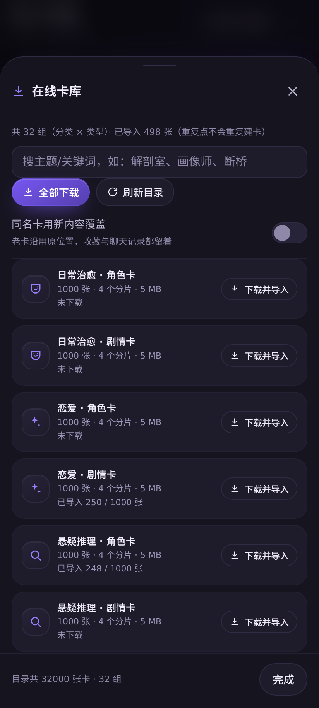
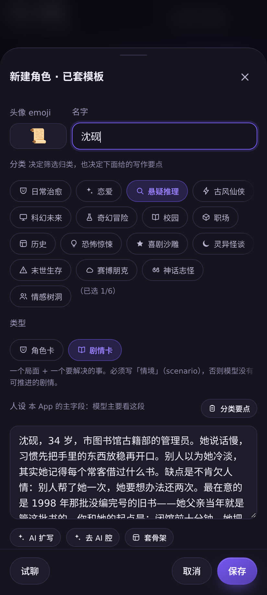
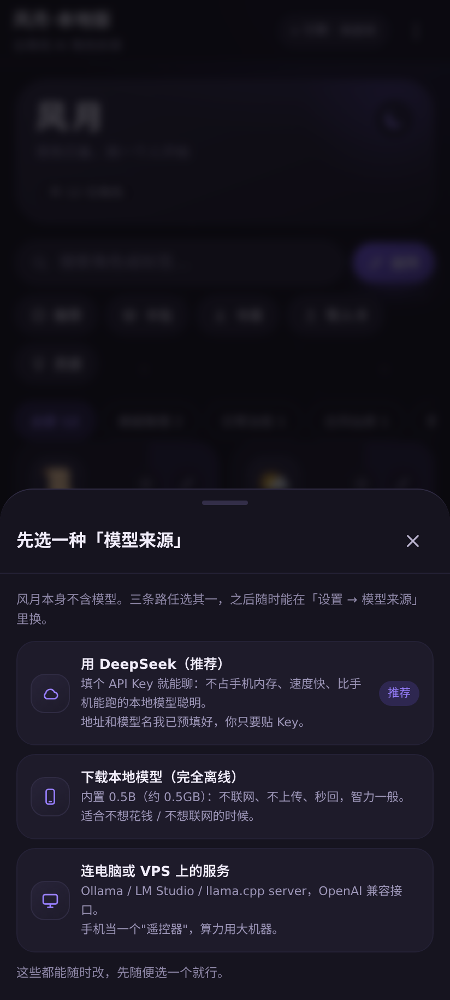

# 🌙 风月 · 本地版

**完全离线的 Android AI 角色扮演 App** —— 本地大模型（llama.cpp / GGUF）直接跑在手机里，
**不联网、不登录、不上传对话**，飞行模式照样聊。内置 32000 张 CC0 原创角色卡，支持 SillyTavern 角色卡导入。

整个 App 在 Termux 里从零构建，**不需要 Android Studio / NDK / Gradle**。

**技术栈与别名**：Android · 本地 LLM / 端侧推理（llama.cpp · GGUF · LiteRT-LM · MediaPipe）· 离线 AI 聊天 ·
AI 角色扮演 / 角色卡（SillyTavern `chara_card_v2`）· 手机跑大模型 · 隐私优先 · Qwen

[English README](README.en.md) · [官网 / 落地页](https://jiurongzhao.github.io/wind-and-moon-local-edition/) · [工程实录](docs/ENGINEERING.md) · [使用说明](docs/user-guide.md)

[-brightgreen?style=for-the-badge)](../../releases)
[](LICENSE)
[-green.svg)](#环境要求)
[](#为什么值得装)
[](runtests.sh)
[](../../releases)

**下载** → [发行版](../../releases) 里的 `fy.apk`（13MB，点开即装）
**镜像** → [GitHub](https://github.com/jiurongzhao/wind-and-moon-local-edition) · [Gitee](https://gitee.com/zhao-jiurong/wind-and-moon-local-edition)

<p align="center">
  
</p>
<p align="center"><sub>真机录屏，全程<strong>飞行模式</strong>：选角色 → 打字 → 本地 0.5B 逐字生成。没有网络，模型跑在手机里。</sub></p>

---

## 为什么值得装

| | |
|---|---|
| 🔒 **真 · 离线** | 引擎是 llama.cpp 官方 Android arm64 预编译库，内置进 APK；模型放本地。**飞行模式照样聊**，对话永远不出这台手机 |
| 🧠 **本机跑得动** | 0.5B 起，3B / 4B 也能加载。实测 0.5B 稳定 **42–52 字/秒**，打字机效果和在线服务一样顺 |
| 🎭 **32000 张原创卡** | 16 类 ×（1000 角色卡 + 1000 剧情卡），全部 **CC0**，**按需下载不进 APK**；还能按关键词只下命中那一片 |
| ✍️ **创作者工具** | 16 类模板 + 48 个人设骨架 + **七维质量评分** + 用你配好的模型做 AI 辅助扩写 + 联网灵感面板 |
| 🔁 **模型来源随便换** | 本地模型 / 局域网 Ollama·LM Studio / 云模型（预置 **DeepSeek**、豆包、通义、智谱、Kimi、OpenAI…），顶栏一键切 |
| 📦 **只有 13MB** | 引擎从 276MB strip 到 27MB 再压进 APK；32000 张卡库走发行版附件，不撑大安装包 |

> 上面每个数字都有实测与 470 项测试撑着 —— 数据、调参过程、21 条踩坑记录见
> **[工程实录 docs/ENGINEERING.md](docs/ENGINEERING.md)**。

## 🚀 快速开始

**装现成的**：到 [发行版](../../releases) 下载 `fy.apk`（约 13MB），手机上点开安装
（需要允许「安装未知来源应用」）。

首次启动后选一条路即可：

| 路径 | 适合 | 怎么弄 |
|---|---|---|
| **云端 API（默认推荐 DeepSeek）** | 想省事、手机内存小、要更好的输出质量 | 设置 → 模型来源 → 外部服务，已预填 DeepSeek，填个 API Key 就能聊 |
| **本地模型（完全离线）** | 不想联网、不想花 API 钱 | 设置 → 模型，下载内置的 0.5B（约 0.5GB），或粘任意模型直链 |
| **局域网自建** | 有电脑/VPS 想跑大模型 | 填 `http://电脑IP:11434/v1`（Ollama / LM Studio / llama.cpp server） |

**自己构建**（Termux 或任意 Linux，不需要 Android Studio / Gradle / NDK）：

```bash
git clone https://gitee.com/zhao-jiurong/wind-and-moon-local-edition.git && cd wind-and-moon-local-edition
./tools/fetch-deps.sh     # 拉两个第三方大件：llama.cpp 预编译引擎 + android.jar
                          # 国内网络慢的话见 CONTRIBUTING 里的「依赖镜像」一节
./build.sh                # 产出 fy.apk（release 签名）
```

详见 [CONTRIBUTING.md](CONTRIBUTING.md)。

### 环境要求

| 项 | 要求 |
|---|---|
| 系统 | Android 10+（minSdk 24），**arm64** 设备 |
| 内存 | 建议 6GB+；0.5B 模型约需 1GB 空闲，3B 约需 3.5GB（内存不够会疯狂换页，实测能慢到十分钟吐不出一个字） |
| 存储 | 模型 0.5～2.5GB + App 本体 13MB |

## 📱 界面预览

<table>
<tr>
<td width="33%"><br><sub>角色页 · 头图 / 搜索 / 分类 / 卡包</sub></td>
<td width="33%"><br><sub>聊天页 · 流式对话与剧情选项</sub></td>
<td width="33%"><br><sub>在线卡库 · 16 类 32000 张，按需下载</sub></td>
</tr>
<tr>
<td width="33%"><br><sub>角色编辑 · 七维质量评分 + AI 辅助</sub></td>
<td width="33%"><br><sub>设置 · 引擎 / 模型来源 / 存储后端</sub></td>
<td width="33%"><br><sub>首次启动三选一：云端 / 本地 / 局域网</sub></td>
</tr>
</table>

> 这些图是 `./tools/shots.sh` 用无头 Chromium 自动生成的（`tools/preview-seed.js` 注入假数据，
> 连「在线卡库」那张也是用假目录把 `/fetch` 拦下来的，所以截图不需要联网）。
> 改完界面重新跑一次即可，**不需要真机也不需要 Android Studio**；
> 浅色聊天页、灵感面板、斜杠指令、卡包、推荐等其余 **14 张**都在 [`docs/shots/`](docs/shots/)。

## 🧩 功能一览

```
角色卡陪聊 · 流式输出 · 长期记忆 · 剧情选项玩法 · 多角色群聊 · 语音朗读与语音输入
角色卡导入导出（SillyTavern chara_card_v2，.json / .png 都吃）· 整库备份/恢复
多存储后端（IndexedDB / SQLite / localStorage / 内存，可一键迁移）· 跨会话聊天记录搜索
内置 160 张原创卡（16 个分类，角色卡 + 剧情卡）· 分类筛选 / 搜索 / 智能推荐 / 卡包一键导入
创作者工具：16 分类模板 + 48 个人设骨架 + 七维质量评分 + AI 辅助扩写 + 联网灵感面板
模型来源自由选（默认 DeepSeek）：内置本地模型 / 粘链接下载任意模型 / 连局域网自建或云模型
首次启动三选一 · 顶栏一键切换模型来源 · 斜杠指令（/继续 /重写 /摘要 /导出 /清空）· 对话导出 Markdown · 正文字号 · 角色收藏
深色 / 浅色 / 跟随系统三档外观 · 手写 Material 3 风格设计系统（无任何外部素材）
采样算法可调：重复/频率/存在惩罚 · DRY · min-p · top-n-σ · XTC · 动态温度 · 选项模式 GBNF 语法约束
长对话不卡：滑窗口时对齐并前移 KV（裁消息不重算）· 记忆改 append-only 消息（更新摘要不撕碎前缀）
```

## 📚 深入细节

README 只讲「这是什么、怎么装」。想抄参数、验数据、避坑的看这里：

| 想知道 | 看 |
|---|---|
| **全部实测数据**、性能调参、21 条踩坑记录、架构与目录结构、界面主题设计 | [docs/ENGINEERING.md](docs/ENGINEERING.md) |
| 怎么装、怎么选模型、玩法、排错 | [docs/user-guide.md](docs/user-guide.md) |
| 进程内引擎（JNI 直连 libllama）为什么值得做、前缀怎么钉住 | [docs/native-engine.md](docs/native-engine.md) |
| 三条本地线路对比（LiteRT-LM / MediaPipe / JNI）实测 | [docs/engine-backends.md](docs/engine-backends.md) |
| 「为什么能 exec APK 里的二进制」证据链、SELinux 策略 | [docs/engine-exec.md](docs/engine-exec.md) |
| JS ↔ Java 接口契约 | [docs/bridge-api.md](docs/bridge-api.md) |
| 卡库目录格式与搜索语义 | [docs/library-catalog.md](docs/library-catalog.md) |
| 贡献指南 / 构建依赖镜像 | [CONTRIBUTING.md](CONTRIBUTING.md) |
| 隐私政策 / 服务条款 | [docs/privacy-policy.md](docs/privacy-policy.md) · [docs/terms.md](docs/terms.md) |

## 许可证与第三方组件

- **风月·本地版代码**：[MIT](LICENSE)。
- **推理引擎**：llama.cpp（MIT）官方 Android 预编译二进制，仅为分发做了 `strip` 与改名，
  未修改代码；许可证全文见 [third_party/llama.cpp-LICENSE](third_party/llama.cpp-LICENSE)。
- **构建期依赖**：`android.jar`（Android SDK，编译期用，不进 APK）。
- **模型**：仓库不含任何模型，推荐型号与各自许可证见 [THIRD_PARTY_NOTICES.md](THIRD_PARTY_NOTICES.md)。
- **图标与界面素材**：全部为风月·本地版原创 —— 界面图标是 `index.html` 内联的 SVG sprite（自绘路径，
  无图标库、无字体文件），启动图标由 `tools/genicons.py` 代码绘制；无第三方素材授权问题。

完整清单：[THIRD_PARTY_NOTICES.md](THIRD_PARTY_NOTICES.md)。

## 内容声明

- 角色回复**由设备本地模型实时生成**，不代表开发者观点，仅供娱乐与创作参考，
  不构成医疗/法律/金融等专业建议。
- 角色卡导入功能支持第三方 `chara_card_v2` 卡，**导入内容的合法性与适当性由使用者自负**；
  本仓库不附带任何第三方角色内容。
- 风月·本地版面向成年人使用。
